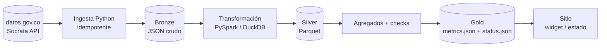

# Pipeline de datos del sitio (widget en vivo)

> El diferenciador: el portafolio consume datos de un pipeline real de Javi. Estado: **Propuesto** (fase 3 del roadmap).

## Objetivo

Mostrar en la home un widget "Pulso del turismo aéreo en Colombia" (o equivalente) con datos frescos y una página `/estado` con la salud del pipeline. Demuestra orquestación, calidad y observabilidad.

## Fuente propuesta

- Aerocivil, "Transporte Aéreo Comercial: Tráfico Origen-Destino" en datos.gov.co (API Socrata). [[POR DEFINIR: confirmar dataset y frecuencia de actualización]]
- Enriquecimiento opcional: festivos de Colombia, TRM (Banco de la República).

## Flujo



## Contrato de salida (`metrics.json`)

```json
{
  "schemaVersion": 1,
  "generatedAt": "2026-11-01T06:00:00Z",
  "period": "2026-08",
  "kpis": [
    { "id": "passengers_total", "label": { "es": "Pasajeros", "en": "Passengers" }, "value": 0, "yoyPct": 0 }
  ],
  "topRoutes": [ { "origin": "BOG", "destination": "MDE", "passengers": 0 } ]
}
```

## Contrato `status.json`

```json
{
  "lastRun": "2026-11-01T06:00:00Z",
  "durationSec": 0,
  "rowsProcessed": 0,
  "checks": [ { "name": "no_nulls_passengers", "passed": true } ],
  "result": "success"
}
```

## Decisiones abiertas

| Tema | Opciones | Estado |
|---|---|---|
| Orquestador | GitHub Action programada (gratis) vs Airflow local / MWAA | [[POR DEFINIR]] |
| Almacenamiento de salida | Rama `data` del repo, release asset, S3 público | [[POR DEFINIR]] |
| Consumo | En build (rebuild diario, 0 JS) vs fetch en cliente (isla) | [[POR DEFINIR]] |
| Repo del pipeline | Mismo repo (`pipeline/`) vs repo separado (proyecto insignia) | [[POR DEFINIR]] |

## Reglas

- Si el pipeline falla, el sitio muestra el último dato válido con su fecha (FR-052).
- `schemaVersion` cambia solo con ADR.
