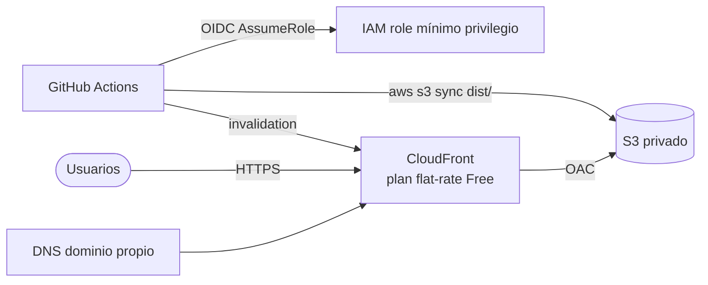

# Despliegue, hosting y CI/CD

> Estado: Fase 1 **Aceptado** (desplegado). Fase 2 y 3 **Propuesto**.

## Fase 1: GitHub Pages (actual)

| Aspecto | Valor |
|---|---|
| Repo | `Bimbitor/datafolio` |
| URL | https://bimbitor.github.io/datafolio/ (ruta base `/datafolio/`) |
| Rama de producción | `main` |
| Fuente de Pages | GitHub Actions (no rama `gh-pages`) |
| Workflow | `.github/workflows/deploy.yml` |
| Disparadores | `push` a `main` y manual (`workflow_dispatch`) |
| Pasos | checkout → setup Node 22 → `npm ci` → `astro build` → `upload-pages-artifact` → `deploy-pages` |
| Rollback | `git revert` del commit y push (redeploy automático) |
| Límites | 1 GB de sitio, ~100 GB/mes de ancho de banda (blando), 10 builds/hora |

## Fase 2: CI de calidad (propuesto)

Workflow `ci.yml` en cada PR:

```
lint + astro check → build → lychee (links) → Lighthouse CI → validación i18n
```

- Protección de rama en `main`: PR obligatorio y CI en verde [[POR DEFINIR: ¿o push directo mientras trabajas solo?]].
- Previews de PR: [[POR DEFINIR: Cloudflare Pages como espejo con previews, o sin previews]].

## Fase 3: AWS S3 + CloudFront (propuesto, proyecto "meta")



- IaC: [[POR DEFINIR: Terraform / AWS SAM / CDK]] en carpeta `infra/`.
- Cuenta AWS: plan Paid con AWS Budgets y alertas (el plan Free se cierra a los 6 meses).
- GitHub Pages queda como respaldo.
- Documentar como caso de estudio corto (versión de datos de la Cloud Resume Challenge).
- Requiere ADR antes de empezar.

## Dominio propio

- [[POR DEFINIR: ¿comprar dominio? candidatos]]
- Si se usa con Pages: archivo `public/CNAME`, registros DNS A/AAAA o CNAME, HTTPS forzado.
