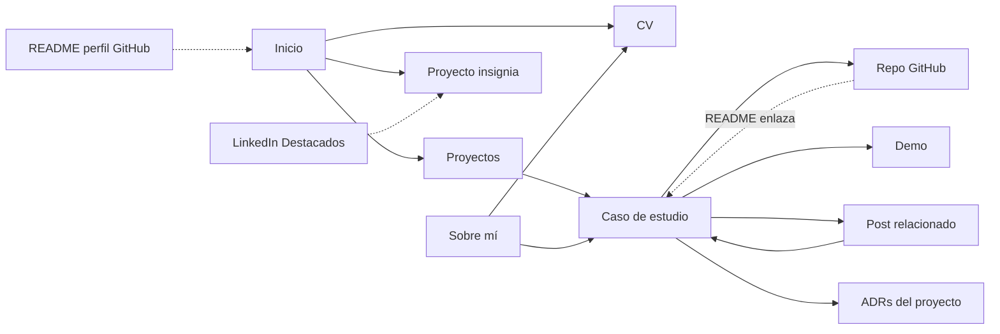

# Arquitectura de información

> Mapa del sitio, rutas y cómo se conectan las secciones. Estado: **Propuesto**

## Mapa del sitio

| Ruta ES | Ruta EN | Página | Prioridad | Feature |
|---|---|---|---|---|
| `/` | `/en/` | Inicio | M | F-003 |
| `/proyectos/` | `/en/projects/` | Listado de proyectos | M | F-005 |
| `/proyectos/[slug]/` | `/en/projects/[slug]/` | Caso de estudio | M | F-006 |
| `/blog/` | `/en/blog/` | Listado de posts | S | F-010 |
| `/blog/[slug]/` | `/en/blog/[slug]/` | Post | S | F-010 |
| `/sobre-mi/` | `/en/about/` | Sobre mí | M | F-004 |
| `/cv/` | `/en/resume/` | CV HTML + descarga PDF | M | F-004 |
| `/lab/` | `/en/lab/` | Experimentos, cómo construyo con IA | C | F-009 |
| `/now/` | `/en/now/` | En qué estoy ahora | C | F-011 |
| `/estado/` | `/en/status/` | Estado del pipeline | C | F-008 |
| `/404` | | No encontrado | S | F-001 |
| `/rss.xml` | `/en/rss.xml` | Feed | S | F-010 |

[[POR DEFINIR: ¿slugs de rutas traducidos (`/sobre-mi` vs `/about`) o iguales en ambos idiomas? Traducidos es mejor SEO; iguales es más simple de mantener.]]

## Navegación

- **Header (todas las páginas):** logo/nombre → Inicio · Proyectos · Blog · Sobre mí · CV · [ES|EN] · [tema].
- **Footer:** GitHub · LinkedIn · Email · RSS · "Construido con Astro, specs en GitHub" · © año actual.
- **Móvil:** menú colapsable accesible (botón con `aria-expanded`), sin JS pesado.

## Interconexión de contenido

Reglas:

1. Todo caso de estudio enlaza a su repo y, si existe, a su post. Todo post sobre un proyecto enlaza de vuelta.
2. Cada repo de proyecto enlaza al caso de estudio en su README (primera sección).
3. Las tecnologías mencionadas en "Sobre mí" enlazan a los proyectos donde se usaron (PR-01).
4. Ninguna página es un callejón sin salida: siempre hay un siguiente paso sugerido.

## Prioridad de contenido en la home (de arriba a abajo)

1. Hero (quién, qué, CTA).
2. Proyectos destacados.
3. Widget en vivo (cuando exista).
4. Últimos posts.
5. Contacto.
