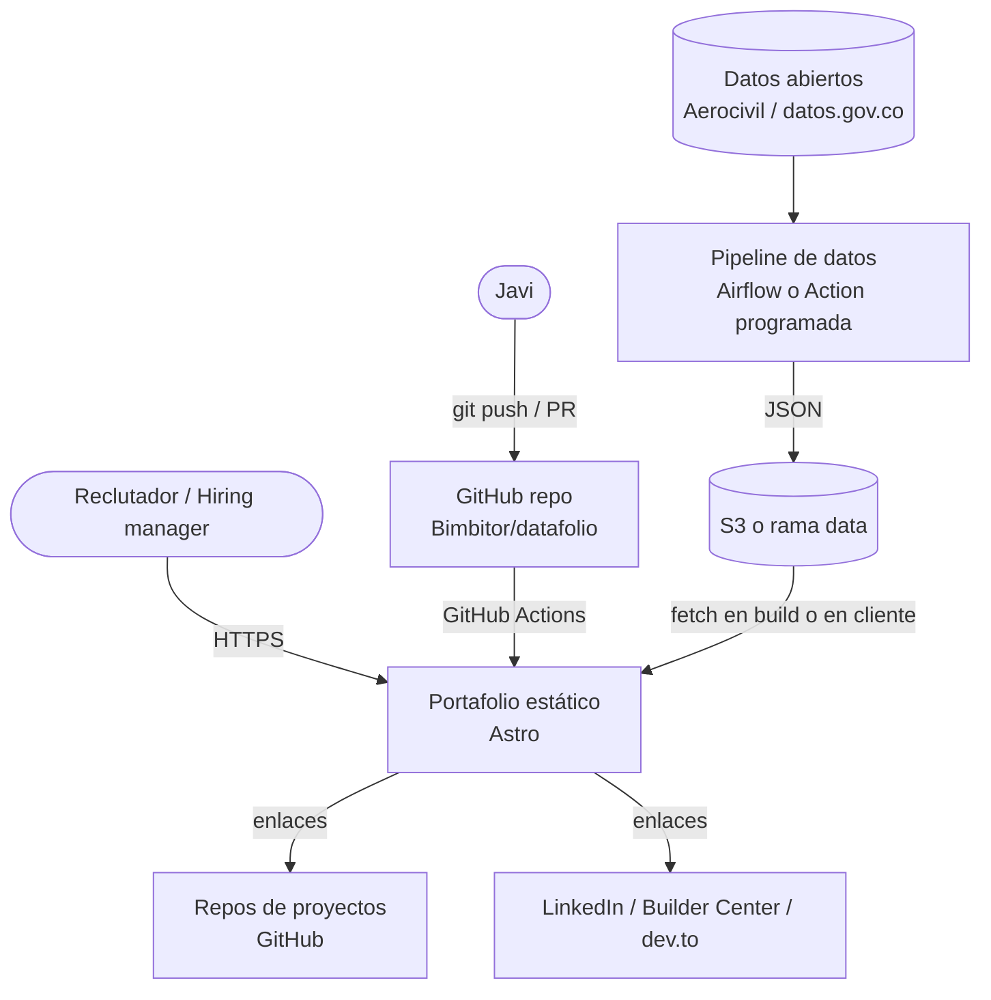
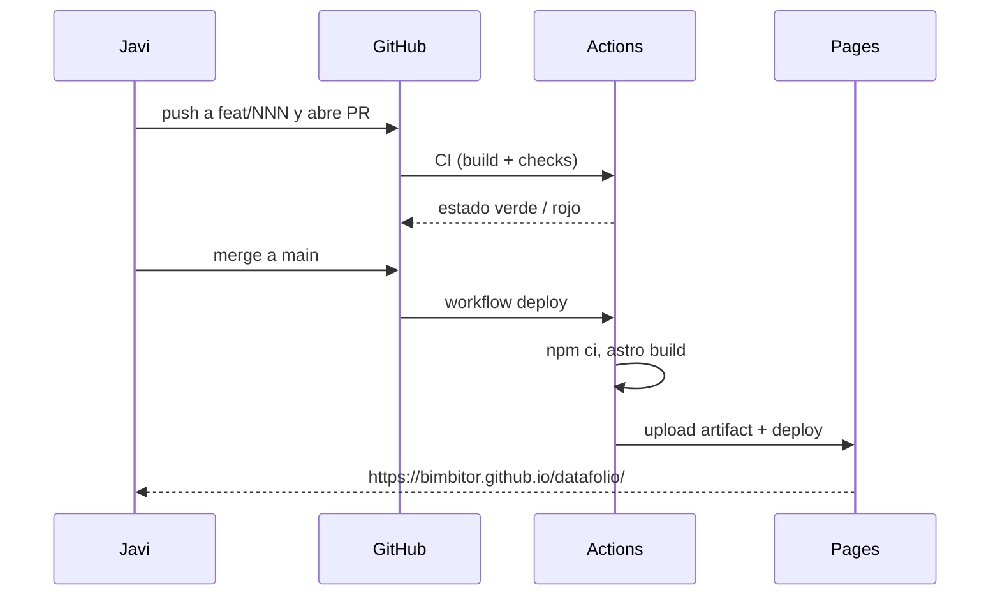

# Arquitectura: visión general

> Estado: **Propuesto**. Las decisiones estructurales se registran en `../adr/`.

## Contexto (C4 nivel 1)



## Contenedores (C4 nivel 2)

| Contenedor | Tecnología | Responsabilidad | Spec |
|---|---|---|---|
| Sitio | Astro + MDX + Tailwind | Renderizar páginas estáticas bilingües | `tech-stack.md` |
| Contenido | Content Collections (MD/MDX + Zod) | Proyectos, posts, CV, datos personales | `content-model.md` |
| CI/CD | GitHub Actions | Build, verificaciones, deploy | `deployment.md` |
| Hosting | GitHub Pages (fase 1), S3 + CloudFront (fase 3, propuesto) | Servir archivos | `deployment.md` |
| Pipeline del widget | Python + (Airflow / Action) + S3 | Producir `metrics.json` | `data-pipeline.md` |
| Analítica | [[POR DEFINIR]] sin cookies | Medir uso | `seo-analytics.md` |

## Flujo de una publicación



## Estructura del repositorio

```
/
├── AGENTS.md / CLAUDE.md     instrucciones para agentes de IA
├── AI_USAGE.md               registro de uso de IA
├── README.md
├── docs/research/            investigación (no vinculante)
├── specs/                    fuente de verdad (este sistema)
├── src/
│   ├── pages/                rutas (es en raíz, en/ para inglés)
│   ├── layouts/              [futuro]
│   ├── components/           [futuro]
│   ├── content/              [futuro] colecciones
│   ├── i18n/                 [futuro] cadenas de UI
│   └── styles/               [futuro]
├── public/                   assets estáticos (favicon, cv.pdf, og)
├── astro.config.mjs
└── .github/workflows/        deploy.yml (+ ci.yml futuro)
```

## Decisiones abiertas

- [[POR DEFINIR]] ¿Plantilla de partida (Starfolio, Astro Nano) o construcción propia? Ver `tech-stack.md`.
- [[POR DEFINIR]] ¿Migrar hosting a AWS en fase 3? Ver `deployment.md`.
- [[POR DEFINIR]] ¿Dominio propio? ¿Cuál?
