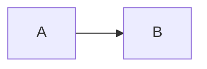

# Plan técnico: F-NNN [Nombre]

| Campo | Valor |
|---|---|
| Spec | [spec.md](spec.md) |
| Estado | Borrador / Aprobado |
| Rama | `feat/NNN-nombre-corto` |

<!-- guía: el CÓMO. Debe poder ejecutarlo otra persona (o un agente) sin preguntarte nada. -->

## 1. Resumen de la solución

## 2. Verificación contra la constitución

| Principio | ¿Cumple? | Nota |
|---|---|---|
| PR-01 Evidencia | | |
| PR-03 Dos clics | | |
| PR-04 Cero JS por defecto | | ¿Agrega JS? ¿Cuánto y por qué? |
| PR-05 Bilingüe | | |
| PR-06 Accesible y rápido | | |
| PR-07 IA documentada | | |
| PR-11 Mantenible | | |

## 3. Diseño

### 3.1 Componentes y archivos

| Archivo | Nuevo / Modificado | Responsabilidad |
|---|---|---|
| `src/...` | Nuevo | |

### 3.2 Flujo de datos

### 3.3 Cambios en el modelo de contenido

<!-- guía: campos nuevos de colecciones; actualiza 02-architecture/content-model.md en el mismo PR. -->

### 3.4 Cadenas de i18n nuevas

| Clave | ES | EN |
|---|---|---|

## 4. Dependencias nuevas

| Paquete | Versión | Por qué | Peso / impacto | Alternativa descartada |
|---|---|---|---|---|

## 5. Decisiones y alternativas

| Decisión | Alternativas | Elección | Motivo | ¿Requiere ADR? |
|---|---|---|---|---|

## 6. Estrategia de pruebas

| Criterio | Cómo se verifica | Automático / Manual |
|---|---|---|
| AC-1 | | |

## 7. Rendimiento y accesibilidad

- Impacto esperado en Lighthouse:
- JS agregado al cliente:
- Consideraciones a11y:

## 8. Despliegue y rollback

## 9. Riesgos técnicos

## 10. Uso de IA previsto

<!-- guía: qué partes planeas delegar a un agente y cómo vas a verificar. Se registra después en AI_USAGE.md. -->
