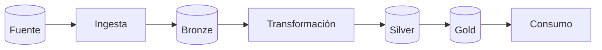

<!-- Plantilla de caso de estudio. Copiar a src/content/projects/{es,en}/<slug>.mdx -->

## Resumen en 30 segundos

<!-- Problema → solución → resultado principal (1 métrica). Diagrama miniatura. -->

## Contexto y problema de negocio

<!-- Quién usaría esto, qué decisión habilita, por qué importa. Usa un caso real del sector. -->

## Datos

| Fuente | Formato | Volumen | Frecuencia | Problemas encontrados |
|---|---|---|---|---|
| | | | | |

## Arquitectura

<!-- Resumen textual del diagrama para accesibilidad. Recorre capa por capa. -->

## Decisiones técnicas y trade-offs

| Decisión | Alternativa descartada | Por qué |
|---|---|---|
| | | |

## Calidad, pruebas y observabilidad

<!-- Checks de datos, tests, idempotencia, reprocesamiento, alertas, costos. -->

## Modelo / análisis

<!-- Si aplica: baseline vs modelo, métrica de validación, reentrenamiento. Si no aplica, borrar. -->

## Resultados

| Métrica | Valor |
|---|---|
| Tiempo de ejecución | |
| Costo mensual | |
| Filas / día | |
| Precisión / error | |

## Uso de IA en el desarrollo

- **Qué hizo la IA:**
- **Qué hice yo:**
- **Sugerencia rechazada y por qué:**
- **Cómo verifiqué:**
- Detalle: [AI_USAGE.md](https://github.com/Bimbitor/[[repo]]/blob/main/AI_USAGE.md)

## Qué haría distinto y próximos pasos

## Enlaces

- Repo · Demo · Post · Video · Docs (dbt docs / notebook renderizado)
