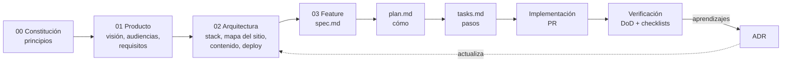

# Sistema de Spec-Driven Development (SDD)

Este directorio es la **fuente de verdad** del portafolio. Nada se construye sin una spec que lo justifique, y si el código y la spec no coinciden, se corrige uno de los dos en el mismo PR.

> Estado del sistema: **plantillas con propuestas iniciales**. Todo lo marcado `Propuesto` o `[[POR DEFINIR]]` está para que Javi lo edite, acepte o descarte.

## Por qué SDD en un portafolio

1. **Demuestra criterio de ingeniería.** Un reclutador técnico puede leer *por qué* se tomó cada decisión, no solo ver el resultado.
2. **Hace que la IA trabaje bien.** Los agentes (Claude Code, Copilot, Cursor) leen `AGENTS.md` y las specs antes de escribir código, así que generan lo que se pidió y no lo que imaginan.
3. **Mantenimiento bajo.** Cuando vuelvas al proyecto en tres meses, las specs te dicen qué existe, por qué y qué falta.

## Flujo



| Capa | Pregunta que responde | Cambia... |
|---|---|---|
| `00-constitution.md` | ¿Qué reglas no se rompen nunca? | Casi nunca. Requiere ADR. |
| `01-product/` | ¿Para quién y qué debe lograr? | Al cambiar de objetivo laboral. |
| `02-architecture/` | ¿Con qué y cómo está organizado? | Con cada ADR aceptado. |
| `03-features/NNN-nombre/` | ¿Qué hace esta funcionalidad y cómo se construye? | Por feature. |
| `04-content/` | ¿Qué se dice y cómo se presenta? | Por proyecto o post. |
| `adr/` | ¿Por qué elegimos X y no Y? | Inmutable una vez aceptado (se reemplaza con otro ADR). |
| `checklists/` | ¿Está listo para empezar / terminar / lanzar? | Rara vez. |

## Ciclo de vida de una feature

```
Borrador → Lista (DoR cumplida) → En progreso → En revisión → Hecha (DoD cumplida)
                                                       ↘ Descartada (con motivo)
```

1. Copia `03-features/_template/` a `03-features/NNN-nombre-corto/`.
2. Llena `spec.md` (el **qué** y el **por qué**). Sin detalles de implementación.
3. Pasa la [Definition of Ready](checklists/definition-of-ready.md).
4. Llena `plan.md` (el **cómo**): componentes, archivos, decisiones. Si una decisión es estructural, crea un ADR.
5. Genera `tasks.md`: pasos pequeños y verificables, cada uno trazable a un requisito.
6. Implementa en una rama `feat/NNN-nombre-corto`. Un PR por feature.
7. Pasa la [Definition of Done](checklists/definition-of-done.md) y actualiza `03-features/README.md`.

## Convenciones de IDs

| Prefijo | Qué es | Dónde vive | Ejemplo |
|---|---|---|---|
| `PR-` | Principio de la constitución | `00-constitution.md` | `PR-03` |
| `FR-` | Requisito funcional | `01-product/requirements.md` | `FR-012` |
| `NFR-` | Requisito no funcional | `01-product/requirements.md` | `NFR-004` |
| `F-` | Feature | `03-features/NNN-*/` | `F-003` |
| `T-` | Tarea dentro de una feature | `tasks.md` | `F-003/T-07` |
| `ADR-` | Decisión de arquitectura | `adr/NNNN-*.md` | `ADR-0002` |
| `AC-` | Criterio de aceptación | `spec.md` | `F-003/AC-2` |

**Trazabilidad:** cada tarea referencia al menos un `FR`/`NFR`, cada `FR` referencia la feature que lo implementa, y cada PR menciona la feature (`F-003`).

## Marcadores

- `[[POR DEFINIR: ...]]`: hueco que Javi debe llenar.
- `Propuesto`: sugerencia basada en la investigación, pendiente de aceptar.
- `Aceptado`: decisión tomada. Cambiarla requiere ADR.
- `<!-- guía: ... -->`: instrucciones para quien llena la plantilla. Se pueden borrar.

## Mapa de archivos

```
specs/
├── README.md                     ← este archivo
├── 00-constitution.md
├── roadmap.md
├── glossary.md
├── 01-product/
│   ├── vision.md
│   ├── audiences.md
│   ├── requirements.md
│   └── success-metrics.md
├── 02-architecture/
│   ├── overview.md
│   ├── tech-stack.md
│   ├── information-architecture.md
│   ├── content-model.md
│   ├── i18n.md
│   ├── design-system.md
│   ├── seo-analytics.md
│   ├── quality-attributes.md
│   ├── deployment.md
│   └── data-pipeline.md
├── 03-features/
│   ├── README.md                 ← backlog e índice de features
│   └── _template/ (spec.md, plan.md, tasks.md)
├── 04-content/
│   ├── voice-and-tone.md
│   ├── project-catalog.md
│   ├── case-study-template.md
│   ├── blog-post-template.md
│   └── about-and-cv.md
├── adr/
│   ├── README.md
│   ├── _template.md
│   └── 0001-adoptar-spec-driven-development.md
└── checklists/
    ├── definition-of-ready.md
    ├── definition-of-done.md
    ├── pr-review.md
    ├── launch.md
    └── quarterly-review.md
```
